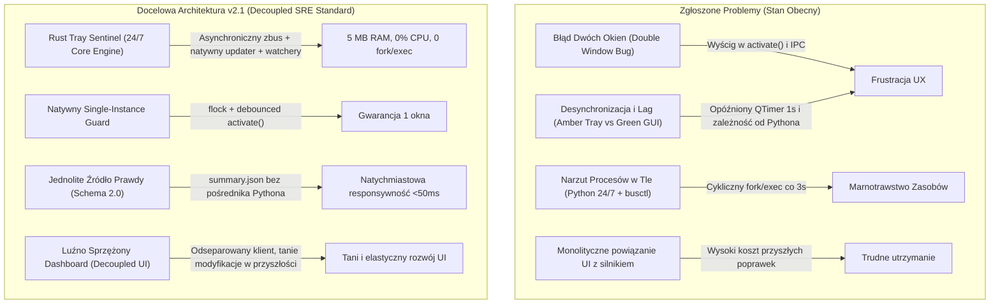

# SysPilot Reconstruction & Modernization Master Plan (v2.1 — SRE Audit Ready)

**Właściciel Projektu:** Karol (Dublin, Ireland)  
**Nadzór Architektoniczny:** SRE Auditor (Auditor Argon Pro) & SysPilot SRE Team  
**Data aktualizacji:** 2026-10-30 (Rewizja v2.1)  
**Status:** `[PENDING SRE RE-AUDIT & USER APPROVAL]`

---

## 1. Diagnoza Problemów i Wymagania Operacyjne (Friction Points)

Na podstawie testów na żywym środowisku oraz przesłanych zrzutów ekranu (`rust_tray.png`, `SYS HEALTH Audit`, `double_window.png`) zdefiniowano docelową architekturę eliminującą 4 główne punkty tarcia:



---

## 2. Filozofia Prezentacji Danych i Architektura Przyszłościowa

### 2.1. Linux Purist Value Standard
SysPilot prezentuje wyłącznie dane o wysokiej wartości decyzyjnej (*Actionable Value*):
1. **Precyzyjny podział aktualizacji (Wysokie Value):**
   * **Core Packages (Krytyczne):** `linux`, `linux-zen`, `systemd`, `nvidia-580xx-dkms`, bootloader (`grub`).
   * **Official Repositories:** Pakiety i biblioteki systemowe z oficjalnych repozytoriów.
   * **AUR Packages:** Oprogramowanie ze społeczności (`yay` / `paru`).
   * **Third-Party Standalone:** Narzędzia instalowane poza pacmanem (`uv`, `goose`, `steam`).
2. **Koniec ze sztucznym szumem:**
   * Usuwamy z tooltipa traya zbędne metryki (wersja jądra, sekundy wieku cache).
   * Tray informuje prosto i zwięźle:
     * 🛡️ *All Systems Operational* (lub 🎮 *GameMode Active*).
     * 🟡 *Updates Available (2 Core, 60 Repo)* LUB *Reboot Required*.
     * 🔴 *Issue Detected: [GPU / Systemd] — Click to inspect*.
3. **Karta Hardware & GPU w GUI:**
   * Dodanie do zakładki *System Health & Hygiene* dynamicznego wiersza GPU (odczyt z `summary.json`: status sterownika, temperatura, brak lockupów modesetu).

### 2.2. Architektura Luźnego Sprzężenia (Tani i Łatwy Rozwój w Przyszłości)
Aby przyszłe modyfikacje interfejsu (np. lifting stylów, migracja do Tauri/Slint/QML czy dodanie nowych widoków) były **tanie, szybkie i nie wymagały dotykania kodu Rust Traya**:
* **Czysty Kontrakt (Decoupled IPC / Data Contract):**
  * Rust Tray Sentinel odpowiada **wyłącznie** za: bycie ultralekkim demonem 24/7 (ikona w KDE, tooltip, menu 5 akcji) oraz wystawianie i weryfikację telemetrii (`summary.json` / IPC).
  * Dashboard (GUI) jest **niezależnym konsumentem**: uruchamia się na żądanie przez `syspilot --gui`, odczytuje dane i zamyka się natychmiast zwalniając pamięć RAM.
  * Zmiana wyglądu lub biblioteki GUI w przyszłości **nie wymaga modyfikacji ani rekompilacji kodu Rust Traya**. Koszt tokenowy kolejnych poprawek UI wynosi grosze.

---

## 3. Zakres Przeniesienia do Silnika Rust (`syspilot-tray`)

Przekształcamy `syspilot-tray` z pasywnego czytacza JSON-a w **aktywnego, autonomicznego wartownika (Sentinel 24/7)**.

```text
rust-tray/src/
├── main.rs            # Pętla Tokio, koordynacja timerów i inotify
├── state.rs           # Model danych, kalkulacja statusu, obsługa Schema 2.0
├── tray.rs            # StatusNotifierItem (KDE Wayland), odchudzone menu (5 opcji)
├── updater.rs         # [NOWOŚĆ] Asynchroniczne sprawdzanie checkupdates, yay, third-party
├── sentinels.rs       # [NOWOŚĆ] Błyskawiczne testy 24/7: reboot pending, db.lck, statvfs dysku
├── gamemode.rs        # [REFAKTOR] Asynchroniczny zbus zamiast Command("busctl") co 3s
├── terminal.rs        # Debounced launcher GUI oraz komend w terminalu
└── tests.rs           # Testy jednostkowe parsera i stanów
```

### 3.1. Asynchroniczny Silnik Detekcji Aktualizacji (`src/updater.rs`)
* Co 1–2 godziny (lub po wybudzeniu stacji roboczej):
  1. **Oficjalne repozytoria:** Uruchomienie `checkupdates` z odizolowaną bazą w `/tmp/checkup-db` $\rightarrow$ automatyczne rozbicie na pakiety Core vs Official.
  2. **AUR:** Uruchomienie `yay -Qua` / `paru -Qua` $\rightarrow$ zliczenie pakietów społeczności.
  3. **Third-Party Standalone:** Szybkie wywołanie `sys-health --software --json` $\rightarrow$ stan narzędzi `uv`, `goose`, `flatpak`, `steam`.
* **Ścisła ochrona GameMode:** Natychmiastowe zamrożenie workera w czasie gry (zero operacji wejścia/wyjścia na dysku i zero spadków FPS).

### 3.2. Krytyczne Operacje Systemowe 24/7 w Rust (`src/sentinels.rs`)
Trzy operacje o zerowym narzucie CPU (<1 ms), które natychmiast wykrywają awarie:
1. **Detekcja `Reboot Pending`:** Sprawdzenie obecności katalogu `/usr/lib/modules/$(uname -r)` na dysku. Jeśli zaktualizowano jądro i stary katalog został usunięty, tray od razu zapala żółty alert z powiadomieniem o wymaganym restarcie.
2. **Detekcja osieroconej blokady Pacmana (`db.lck`):** Sprawdzenie obecności `/var/lib/pacman/db.lck`. Jeśli plik istnieje, a żaden proces `pacman` ani `yay` nie działa — natychmiastowe zgłoszenie błędu.
3. **Monitorowanie przestrzeni dyskowej (`/` i `/home`):** Natywne wywołanie `statvfs` (0 procesów zewnętrznych, natychmiastowy alert gdy dysk osiągnie >90%).

### 3.3. Refaktoryzacja D-Bus GameMode (`src/gamemode.rs`)
* Zastąpienie zewnętrznego `Command::new("busctl")` bezpośrednim asynchronicznym zapytaniem przez crate `zbus 5.19`.
* Eliminacja **28 800 wywołań fork/exec na dobę**.

---

## 4. Likwidacja Błędów UX i Responsywności (Faza 1)

1. **Eliminacja Błędu Dwóch Okien (Double Window Bug):**
   * **Warstwa 1 (Rust):** Atomowy debounce w `tray.rs` (`activate()`) — blokada kolejnych wywołań przez **1.5 sekundy** od uruchomienia GUI.
   * **Warstwa 2 (Python Native Guard):** Nieblokujący `fcntl.flock(lock_fd, fcntl.LOCK_EX | fcntl.LOCK_NB)` na pliku `~/.local/state/syspilot/.gui.lock` przed importem modułów Qt. Proces bez blokady wysyła sygnał `ACTIVATE` do `QLocalSocket` i natychmiast kończy działanie.
2. **Likwidacja Opóźnienia i Desynchronizacji (Amber vs Green):**
   * Usunięcie sztucznego opóźnienia `QTimer.singleShot(1000)` w GUI.
   * Natychmiastowy odczyt jednolitej telemetrii przy starcie okna.
   * Dodanie hooka po `syspilot -u` (Guarded Upgrade), który po zamknięciu terminala natychmiast odświeża stan i przywraca zieloną tarczę.

---

## 5. Standardy Bezpieczeństwa, Uniwersalizmu i AI Copilot

1. **Żelazna Segregacja Tożsamości (Private Profiles vs `SysPilot AI Copilot`):**
   * Kategoryczny zakaz używania nazw prywatnych agentów oraz prefiksów lokalnych stacji w publicznym repozytorium SysPilot.
   * Publiczna nazwa asystenta: **`SysPilot AI Copilot`** (szablon `copilot-admin`).
   * Prywatne profile konfigurowane są **wyłącznie** przez lokalny plik `~/.config/syspilot/config.env` (w `.gitignore`).
2. **100% Uniwersalizm Sprzętowy:**
   * Dynamiczny odczyt sekcji GPU z `summary.json` bez hardkodowania parametrów GTX 970 / DP MST.
3. **Rust Zero-Hallucination Contract & Obowiązek Context7:**
   * **Audytor SRE (Argon Pro) oraz wykonawcy mają bezwzględny obowiązek weryfikacji API crate'ów (`zbus 5.19`, `tokio`, `ksni`, `notify`) przez serwer MCP Context7** przed formułowaniem kodu lub blueprintów. Zakaz zgadywania metod z pamięci.

---

## 6. Protokół Wdrożenia (4 Fazy)

* **Faza 1: Szybkie poprawki UX & IPC** — Debouncing w Rust, `fcntl.flock` w Pythonie, likwidacja sztucznego opóźnienia 1s w GUI.
* **Faza 2: Silnik Rust 24/7 & D-Bus** — Natywny `zbus` w `gamemode.rs`, asynchroniczny `updater.rs`, testy `sentinels.rs` (reboot pending, db.lck, statvfs), odchudzenie menu traya do 5 pozycji.
* **Faza 3: GUI & Neutralna Integracja AI** — Dynamiczny wiersz GPU, podpięcie konfiguracji `config.env`, wyczyszczenie reliktów Goose.
* **Faza 4: Weryfikacja & Kompilacja** — `cargo clippy --locked --all-targets -- -D warnings`, `cargo test --locked`, weryfikacja na sesji KDE Wayland.
