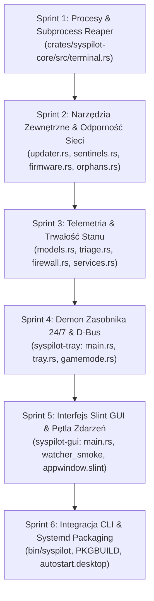
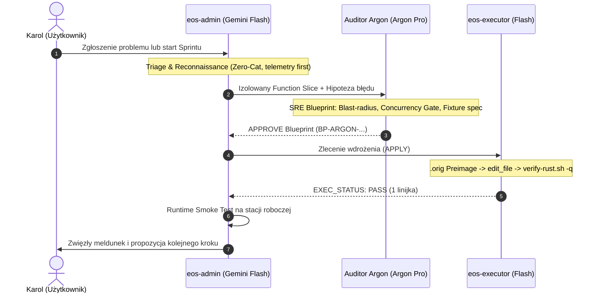

# Kompleksowy Plan Audytu Architektonicznego: `sysPilot_SRE Audit`

## 1. Filozofia i Cel Strategiczny: *„Do It Right the First Time”*

Projekt **SysPilot** przeszedł udaną transformację z monolitu pythonowego (PyQt6/sentinel) do nowoczesnego, czystego Rusta v2.0 (Slint 1.18 + Tokio + Zbus). Po pierwszych dniach działania na stacji roboczej Karola i likwidacji wczesnych usterek (PATCH-017, PATCH-018), wchodzimy w fazę **proaktywnego hartowania architektury (Proactive Reliability Hardening)**.

> [!IMPORTANT]
> **Zasada Jakościowa (Quality Over Speed):**
> Wypuszczanie niedopracowanego wydania produkcyjnego (z LTO), a następnie wielokrotne hotfixowanie go na żywym systemie, jest najbardziej kosztowne pod kątem czasu i uwagi użytkownika. Wolimy poświęcić 20–30 minut więcej na głęboki audyt wycinka kodu, napisać dla niego automatyczny test headless i raz na zawsze zamknąć dany wektor błędów.

---

## 2. Podział Programu na 6 Segmentów Audytowych (Audit Sprints)

SysPilot liczy łącznie około **4 300 linii kodu w języku Rust**. Dzielimy go na 6 wyizolowanych segmentów o niskim promieniu rażenia (*blast radius*), które Audytor SRE (Argon Pro) może weryfikować krok po kroku bez ryzyka halucynacji i nadmiaru tokenów:



### 📋 Szczegółowy Zakres Sprintów:

| Sprint | Moduły & Pliki | Kluczowe Ryzyka do Zbadania | Bramka Akceptacyjna (Definition of Done) |
|:---|:---|:---|:---|
| **Sprint 1: Subprocess Engine** | `syspilot-core/src/terminal.rs`<br/>`syspilot-core/src/copilot.rs`<br/>`bin/syspilot-faf-repair` | • Wycieki procesów-zombie przy nagłym zamknięciu okna emulatora.<br/>• Zawieszenie kolejki `mpsc::sync_channel(MAX_TERMINALS=8)`.<br/>• Wstrzykiwanie znaków specjalnych w argumentach shella (`spawn_shell_task`).<br/>• Blokowanie wątków i zawieszenie `COPILOT_IN_FLIGHT` przy braku timeoutu API. | 🟢 **100% ZAKOŃCZONE & CERTYFIKOWANE (`BP-ARGON-SPRINT-01-COMPLETION-001`)**<br/>• Testy wielowątkowe `test_killed_child_reaped_and_slot_freed` (brak zombie, zwolnienie slotu przy SIGKILL) oraz `test_copilot_timeout_enforcement` (90s timeout, natychmiastowe przerwanie). |
| **Sprint 2: Network & Pacman I/O** | `syspilot-core/src/updater.rs`<br/>`syspilot-core/src/sentinels.rs`<br/>`syspilot-core/src/firmware.rs`<br/>`syspilot-core/src/orphans.rs` | • Brak twardych timeoutów w wywołaniach `checkupdates`, `yay`, `arch-audit`, `fwupdmgr` (ryzyko zawieszenia przy awarii sieci lub mirrora).<br/>• Race conditions wokół `/var/lib/pacman/db.lck`.<br/>• Odporność klasyfikatora NVRAM quirks w `firmware.rs`. | 🟢 **100% ZAKOŃCZONE & CERTYFIKOWANE (`BP-ARGON-SPRINT-02-001`)**<br/>• Twarde timeouty i `kill_on_drop(true)` we wszystkich wywołaniach zewnętrznych (`updater.rs`, `security.rs`, `firmware.rs`, `orphans.rs`).<br/>• Ochrona TOCTOU w `check_pacman_lock_at`.<br/>• Hermetyczny test suite (29/29 core PASS, 42/42 workspace PASS). |
| **Sprint 3: Telemetry & State Ingestion** | `syspilot-core/src/models.rs`<br/>`syspilot-core/src/triage.rs`<br/>`syspilot-core/src/firewall.rs`<br/>`syspilot-core/src/services.rs` | • Niepełne lub uszkodzone pliki `status.json` i `summary.json`.<br/>• Spójność atomowego zapisu `.tmp.<pid>` -> `rename`.<br/>• Obsługa zegara systemowego (clock-skew, podróż w czasie w strefach czasowych).<br/>• Fałszywe alarmy o failed services (systemd transient units). | 🟢 **100% ZAKOŃCZONE & CERTYFIKOWANE (`BP-ARGON-SPRINT-03-001`)**<br/>• Tolerancja clock-skew/NTP 60s w `models.rs`.<br/>• Odporność na zniekształcony JSON (property-based fuzzing).<br/>• Kolizyjnoodporny zapis atomowy z fsync katalogu nadrzędnego.<br/>• Różnicowanie statusu `user_manager_available` w `services.rs`.<br/>• Hermetyczny test suite (34/34 core PASS, 47/47 workspace PASS). |
| **Sprint 4: 24/7 Tray Sentinel & D-Bus** | `syspilot-tray/src/main.rs`<br/>`syspilot-tray/src/tray.rs`<br/>`syspilot-tray/src/gamemode.rs`<br/>`syspilot-tray/src/tests.rs` | • Wycieki deskryptorów inotify w module `notify` przy długim uptime.<br/>• Odporność na restart demona D-Bus (zerwanie i ponowne nawiązanie połączenia z GameMode).<br/>• Sztorm zadań triage w tle i kolizje na `db.lck`.<br/>• Czysty shutdown przy wylogowaniu (`SIGTERM`). | 🟢 **100% ZAKOŃCZONE & CERTYFIKOWANE (`BP-ARGON-SPRINT-04-001`)**<br/>• Leniwa re-koneksja D-Bus i buforowanie proxy w `GameModeWatcher`.<br/>• Zapobieganie wyciekom deskryptorów inotify (`unwatch` + `is_dir()` + clean exit).<br/>• Atomowa blokada deduplikacji zadań triage (`triage_in_flight: Arc<AtomicBool>`).<br/>• Odporny shutdown z 2-sekundowym timeoutem.<br/>• Hermetyczny test suite (16/16 tray PASS, 51/51 workspace PASS). |
| **Sprint 5: GUI Runtime & Threading** | `syspilot-gui/src/main.rs`<br/>`crates/syspilot-gui/ui/*.slint`<br/>`tests/watcher_smoke.rs` | • Ścisła weryfikacja thread-affinity we wszystkich callbackach Slinta.<br/>• Flaga atomowa `COPILOT_IN_FLIGHT` i zabezpieczenie przed podwójnym kliknięciem.<br/>• Prawidłowe skalowanie interfejsu i brak lagów na Waylandzie. | Rozszerzenie `watcher_smoke.rs` o testy symulacji kliknięć i asynchronicznego Copilota. |
| **Sprint 6: CLI & Distribution Cutover** | `bin/syspilot`<br/>`packaging/PKGBUILD`<br/>`autostart/syspilot.desktop` | • Standard POSIX argumentów shella.<br/>• Odporność na brak zainstalowanego `sys-health`.<br/>• Zapobieganie duplikatom autostartu (`X-systemd-skip=true`). | Test suite weryfikujący flagi CLI (`-s`, `-j`, `--audit`, `--help`) i czystość metadanych pakietu. |

---

## 3. Analiza Luk w Toolingu i Nowoczesne Narzędzia dla Języka Rust

Aby podnieść jakość do poziomu komercyjnego oprogramowania systemowego, wdrażamy zestaw nowoczesnych narzędzi wspomagających weryfikację:

```mermaid
flowchart LR
    subgraph Tooling Obecny ["Obecny Tooling (Minimalny)"]
        T1["cargo fmt"]
        T2["cargo clippy (D warnings)"]
        T3["cargo test"]
    end

    subgraph Tooling v2 ["Rozszerzony Tooling v2.0 (SRE Hardened)"]
        T4["cargo-audit & cargo-deny<br/>(Weryfikacja CVE i licencji zależności)"]
        T5["proptest / quickcheck<br/>(Fuzzing i testy odporności parserów)"]
        T6["cargo-machete<br/>(Wykrywanie martwych zależności w Cargo.toml)"]
        T7["Per-Crate Test Accounting<br/>(Brak iluzji 0-testów w CI)"]
    end

    Tooling Obecny --> Tooling v2
```

### Proponowane Narzędzia do Włączenia do `dev-tools/`:
1. **`cargo-audit` (Skaner podatności):**  
   Weryfikuje `Cargo.lock` pod kątem znanych luk bezpieczeństwa w bazie RustSec.
2. **`cargo-deny` (Kontrola łańcucha dostaw):**  
   Blokuje zduplikowane wersje bibliotek i podejrzane licencje.
3. **`proptest` (Property-Based Testing dla parsera `models.rs`):**  
   Zamiast testować tylko jeden "poprawny" plik JSON, `proptest` generuje tysiące losowych mutacji formatu i gwarantuje, że `read_system_snapshot()` nigdy nie spanikuje (`panic!`) w runtime stacji roboczej.
4. **`cargo-machete`:**  
   Błyskawiczne wykrywanie niepotrzebnych zależności w `Cargo.toml`, co zmniejsza czas kompilacji i rozmiar plików binarnych.

---

## 4. Modernizacja Workflow Triady Agentów (`eos-admin` ➔ `eos-sre-auditor` ➔ `eos-executor`)

Wprowadzamy sformalizowany, asymetryczny podział odpowiedzialności między agentami:



### Role i Odpowiedzialności w Nowej Strukturze:
1. **`eos-admin` (Triage & Workstation Copilot):**  
   * Bada problem w środowisku Karola, zbiera telemetrię i wycina badany kod za pomocą `slice.sh` lub `git grep`.
   * **Nie podejmuje decyzji architektonicznych solo** przy kodzie Rusta — formuluje precyzyjny problem statement dla Argona.
   * Przeprowadza końcowy test dymny (*Runtime Smoke Test*) na żywym procesie przed zamknięciem zadania.
2. **`eos-sre-auditor` (Argon Pro - Architectural Brain):**  
   * Prowadzi głębokie rozumowanie (*high-order reasoning*), analizuje niezmienniki wielowątkowości (Slint/Tokio thread-affinity), weryfikuje sygnatury w Context7 MCP i projektuje testy headless.
   * **Zakaz bezpośrednich edycji plików** — produkuje wyłącznie formalny blueprint z decyzją `APPROVE` / `DENY`.
3. **`eos-executor` (Hands - Flash):**  
   * Działa w trybie `NO_CHATTER` (maksymalna oszczędność tokenów).
   * Tworzy kopie `.orig`, nanosi zmiany przez `edit_file`, uruchamia `verify-rust.sh -q`.
   * W razie niepowodzenia po 2 próbach wykonuje natychmiastowy bezpieczny rollback (`.orig`).

---

## 5. Następny Krok

Przekazujemy niniejszy dokument do **Audytora Argon Pro** w celu:
1. Formalnej weryfikacji i zatwierdzenia podziału na 6 sprintów.
2. Przeprowadzenia researchu na temat rekomendowanych narzędzi cargo i bibliotek testowych.
3. Wyznaczenia pierwszego pakietu do realizacji (**Sprint 1: `terminal.rs` & procesy potomne**).
