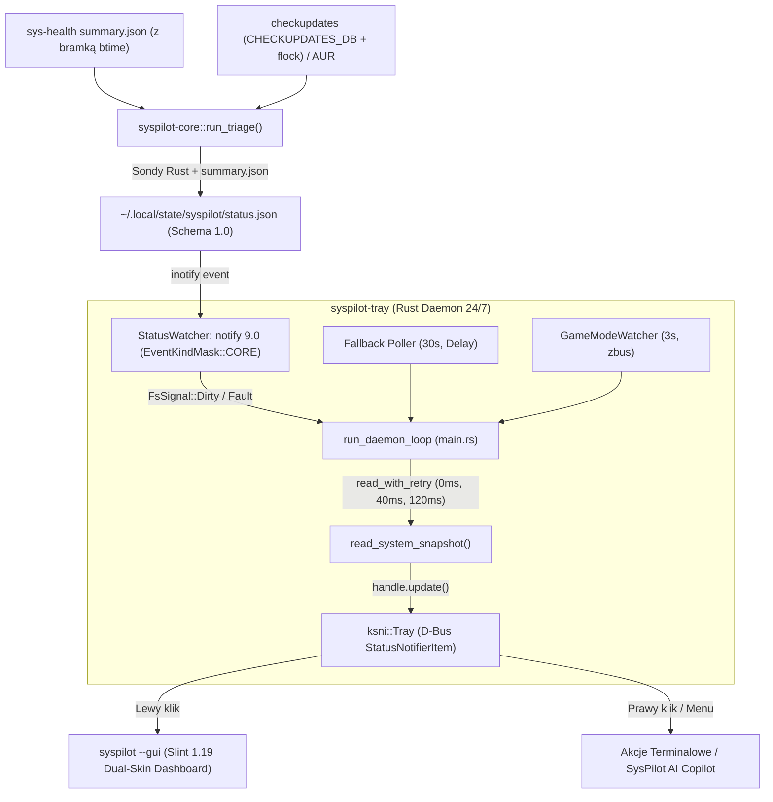

# SysPilot Rust Tray (`syspilot-tray`) — Dokumentacja Architektury i Stanu Obecnego

**Wersja:** 2.1.7 (Rust Edition 2024, workspace `syspilot-tray`)  
**Środowisko:** Arch Linux / EndeavourOS / KDE Plasma Wayland & X11  
**Cel komponentu:** Ultralekki daemon rezydentny (StatusNotifierItem) monitorujący zdrowie stacji roboczej 24/7 z minimalnym narzutem CPU i pamięci RAM, z bezblokującym startem SNI oraz natywnym D-Bus.

---

## 1. Topologia Modułowa i Zależności Crate'ów

Kompilacja i konfiguracja w głównym `Cargo.toml` opiera się na profilu `[profile.release]` z `opt-level = 3`, `lto = true`, `codegen-units = 1`, `panic = "abort"` oraz `strip = true`.

### 1.1. Zewnętrzne Crate'y
* **`ksni = "0.3.7"`** (`async-io`, `default-features = false`): Implementacja specyfikacji freedesktop / KDE StatusNotifierItem (SNI) przez D-Bus. Wymaga `zbus ^5`.
* **`zbus = "5.19"`**: Natywna komunikacja D-Bus dla `ksni` oraz bezforkowego monitoringu `GameModeWatcher` (przypięta do linii `5.x` ze względu na `ksni 0.3.7` i `slint 1.19.0` / `accesskit_unix`).
* **`notify = "9.0.0"`**: Zdarzeniowy nasłuch inotify na katalogu stanu z filtrowaniem jądra `EventKindMask::CORE` (eliminuje wybudzenia przy `IN_OPEN` / `IN_CLOSE_WRITE`).
* **`tokio = "1.53.3"`**: Jednowątkowy runtime asynchroniczny (`flavor = "current_thread"` z flagami `macros`, `rt`, `signal`, `sync`, `time`).
* **`serde = "1.0.229"` & `serde_json = "1.0.154"`**: Deserializacja i rygorystyczna walidacja schematu telemetrii JSON.

### 1.2. Struktura Kodu Źródłowego (`crates/syspilot-tray/src/`)

```text
crates/syspilot-tray/src/
├── main.rs         # Pętla Tokio (select!), StatusWatcher (notify 9.0), TriageGuard, malloc_trim
├── state.rs        # Re-eksport modeli stanu z syspilot-core::models
├── tray.rs         # Implementacja cechy ksni::Tray (ikony, status SNI, tooltip, menu kontekstowe)
├── gamemode.rs     # Natywna detekcja Feral GameMode przez zbus (CacheProperties::No)
├── sentinels.rs    # Re-eksport lokalnych wartowników z syspilot-core::sentinels
├── terminal.rs     # Re-eksport launchera terminala i GUI z syspilot-core::terminal
├── updater.rs      # Re-eksport sond aktualizacji z syspilot-core::updater
├── dbus_test.rs    # Hermetyczne testy D-Bus pod izolowanym dbus-run-session
└── tests.rs        # Testy jednostkowe maszyny stanów, inotify, tooltipów i bramek pre-boot
```

---

## 2. Architektura Przepływu Telemetrii (Data Flow Pipeline)

Łańcuch telemetrii opiera się na bezblokującym starcie SNI i bezpośredniej integracji z `syspilot-core`:



### 2.1. Mechanizm Odczytu, Odporności i Kontroli Pamięci (`main.rs`)
1. **Natychmiastowa rejestracja SNI:** `spawn_tray_service(tray)` rejestruje ikonę przed uruchomieniem pierwszego triage'u w tle (`trigger_startup_triage`), dzięki czemu ikona pojawia się od razu nawet przy braku sieci.
2. **Pasywny nasłuch zdarzeń (`StatusWatcher`):** `notify 9.0` z `EventKindMask::CORE` nasłuchuje wyłącznie na katalogu nadrzędnym (`CREATE`, `MODIFY`, `MOVE`, `REMOVE`), ignorując odczyty `Access`; w razie błędu inotify `handle_fault()` rozbraja watcher i przełącza na polling fallback, a `ensure_watching()` podejmuje automatyczną odbudowę.
3. **Debounce i izolacja zadań:** `FsSignal::Dirty` używa okna debounce `100 ms` i drenuje kanał z zachowaniem ewentualnego `FsSignal::Fault`; `TriageGuard` (`Arc<AtomicBool>`) zapobiega nakładaniu się zadań triage'u, a po każdej rundzie `trim_heap()` wywołuje `libc::malloc_trim(0)`.
4. **Potrójny ponowny odczyt (`read_with_retry`) i limit rozmiaru:** Odczyty w odstępach `0 ms`, `40 ms`, `120 ms` z twardym limitem `MAX_STATUS_BYTES` w `syspilot-core` chronią przed częściowymi zapisami i awarią schematu.

---

## 3. Prezentacja w Zasobniku (Tray Presentation Layer)

Implementacja w `tray.rs` zarządza integracją z panelem KDE Plasma Wayland / X11:

### 3.1. Maszyna Stanów i Ikony (`icon_name()`)

| Stan Systemu (`effective_status`) | Warunek Dodatkowy | Ikona Systemowa | Stan SNI |
|---|---|---|---|
| **`ACTION_REQUIRED`** | Błędy krytyczne (`errors > 0`) lub flaga akcji | `dialog-error` 🔴 | `NeedsAttention` |
| **`PRE_FLIGHT_ATTENTION`** | Ostrzeżenia, aktualizacje (`updates > 0`), dead primary mirror lub `reboot_pending` | `dialog-warning` 🟡 | `NeedsAttention` |
| **Błąd Danych / Cache Stale** | `source_error != None` lub wiek cache > 6h | `dialog-warning` 🟡 | `NeedsAttention` |
| **`ALL_CLEAR` / `FLIGHT_READY`** | Aktywny Feral GameMode (`gamemode_active == true`) | `input-gaming` 🎮 | `Active` |
| **`ALL_CLEAR` / `FLIGHT_READY`** | Stan spoczynku / normalna praca | `security-high` 🛡️ | `Active` |

### 3.2. Szczegółowy Tooltip (`tool_tip()`)
Po najechaniu kursorem na ikonę zasobnika generowany jest ustrukturyzowany blok informacji:
* **Tytuł:** Kontekstowy status (np. `SysPilot — GameMode active` lub `SysPilot — Status: FLIGHT_READY`).
* **Opis wieloliniowy:**
  ```text
  Kernel: <kernel>
  Updates: 0 (core 0, regular 0, AUR 0)
  Errors: 0 | Warnings: 0 | Reboot: no
  Cache age: 42s
  ```
  *(Dodatkowo przy aktywnych anomaliach wyświetlane są skrócone wpisy z `build_dashboard_anomalies()`, narzędzia standalone oraz ostrzeżenia mirrorlist).*

### 3.3. Interakcja z Użytkownikiem
* **Lewy Klik (`activate`):** Uruchamia `terminal::spawn_detached_gui()` (`syspilot --gui`), otwierając natywny Dashboard Slint 1.19 (LCARS / Classic) z blokadą jednej instancji (`libc::flock`).
* **Prawy Klik (Menu Kontekstowe):** Nagłówek statusu, `Open SysPilot Dashboard`, akcje diagnostyczne i utrzymaniowe CLI (`-s`, `-a`, `-u`, `-g`, `-m`, `-o`), konfiguracja `SysPilot AI Copilot` (`--copilot-shell`) oraz `Exit SysPilot` (zamykające pętlę z timeoutem `shutdown_tray_handle` = 2s).

---

## 4. Testy i Weryfikacja

* **Testy jednostkowe (`tests.rs`):** Pokrywają maszynę stanów SNI, cache aktualizacji, narzędzia standalone, anomalie dashboardu, bramkę pre-boot `btime`, `dispatch_notify_result` oraz `StatusWatcher` (późne utworzenie katalogu, brak wybudzeń przy odczycie, atomowe `rename` i odtworzenie po błędzie).
* **Testy izolowane D-Bus (`dbus_test.rs`):** Uruchamiane w prywatnej magistrali `dbus-run-session` bez dostępu do żywej sesji użytkownika; weryfikują `GameModeWatcher` oraz rejestrację i wyrejestrowanie `ksni::Tray` w `StatusNotifierWatcher`.
