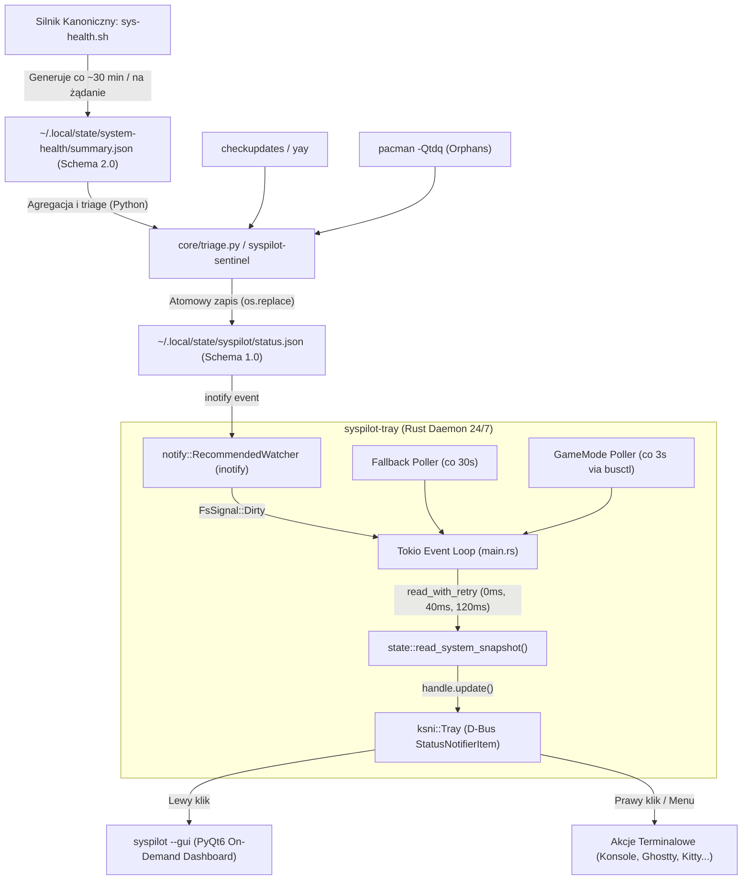

# SysPilot Rust Tray (`syspilot-tray`) — Dokumentacja Architektury i Stanu Obecnego

**Wersja:** 0.2.1 (Rust Edition 2024, MSRV 1.85)  
**Środowisko:** EndeavourOS / KDE Plasma 6.8+ Wayland  
**Cel komponentu:** Ultralekki daemon rezydentny (StatusNotifierItem) monitorujący zdrowie stacji roboczej 24/7 z zerowym narzutem CPU i minimalnym zużyciem pamięci RAM (~4.9 MB RSS).

---

## 1. Topologia Modułowa i Zależności Crate'ów

Kompilacja i konfiguracja w `Cargo.toml` opiera się na profilu `[profile.release]` z `opt-level = 3`, `lto = true`, `codegen-units = 1`, `panic = "abort"` oraz `strip = true`.

### 1.1. Zewnętrzne Crate'y
* **`ksni = "0.3.6"`**: Implementacja specyfikacji freedesktop / KDE StatusNotifierItem (SNI) przez D-Bus. Wersja 0.3 oparta jest wewnętrznie na asynchronicznym `zbus`.
* **`notify = "8.2.0"`**: Asynchroniczny / event-driven nasłuch zdarzeń inotify systemu plików linuksa na katalogu stanu.
* **`tokio = "1.53.3"`**: Jednowątkowy runtime asynchroniczny (`flavor = "current_thread"` z flagami `macros`, `rt`, `signal`, `sync`, `time`).
* **`serde = "1.0.229"` & `serde_json = "1.0.154"`**: Deserializacja i rygorystyczna walidacja schematu telemetrii JSON.

### 1.2. Struktura Kodu Źródłowego (`src/`)

```text
rust-tray/src/
├── main.rs         # Główna pętla Tokio (select!), obsługa inotify, polling fallback, shutdown
├── state.rs        # Parsowanie status.json, walidacja schematu v1.0, kalkulacja effective_status
├── tray.rs         # Implementacja cechy ksni::Tray (ikony, status SNI, tooltip, menu kontekstowe)
├── gamemode.rs     # Detekcja Feral GameMode (obecnie przez proces zewnętrzny busctl / gamemoded)
├── terminal.rs     # Wywoływanie GUI na żądanie oraz komend CLI w terminalu (child reaper)
└── tests.rs        # Testy jednostkowe schematu, spójności liczników aktualizacji i wieku cache
```

---

## 2. Architektura Przepływu Telemetrii (Data Flow Pipeline)

Obecny łańcuch telemetrii opiera się na architekturze trójstopniowej:



### 2.1. Mechanizm Odczytu i Ochrony Przed Wyścigami (`state.rs` & `main.rs`)
1. **Pasywny nasłuch zdarzeń (Zero-Polling):** `notify` nasłuchuje zdarzeń `Create`, `Modify`, `Remove` na katalogu nadrzędnym `~/.local/state/syspilot`.
2. **Debounce i drenowanie:** Po odebraniu `FsSignal::Dirty` wątek czeka 100 ms na zakończenie operacji dyskowych i drenuje nagromadzone w kanale `mpsc` powiadomienia.
3. **Potrójny ponowny odczyt (`read_with_retry`):** Ponieważ Python zapisuje plik atomowo przez `tempfile` i `rename`, tray podejmuje próby odczytu w odstępach `0 ms`, `40 ms` oraz `120 ms`, zapobiegając odczytowi pustego lub blokowanego deskryptora.
4. **Ograniczenie rozmiaru i obrona:** Limit odczytu ustawiony na sztywno na 1 MB (`MAX_STATUS_BYTES = 1024 * 1024`). Błąd schematu lub przekroczenie rozmiaru nie powoduje paniki procesu, lecz przestawia tray w stan ostrzegawczy z opisem błędu.

---

## 3. Prezentacja w Zasobniku (Tray Presentation Layer)

Implementacja w `tray.rs` zarządza integracją z panelem KDE Plasma Wayland:

### 3.1. Maszyna Stanów i Ikony (`icon_name()`)

| Stan Systemu (`effective_status`) | Warunek Dodatkowy | Ikona Systemowa | Stan SNI |
|---|---|---|---|
| **`ACTION_REQUIRED`** | Błędy krytyczne (`errors > 0`) lub flaga akcji | `dialog-error` 🔴 | `NeedsAttention` |
| **`PRE_FLIGHT_ATTENTION`** | Ostrzeżenia (`warnings > 0`), pakiety do aktualizacji (`updates > 0`), lub `reboot_pending` | `dialog-warning` 🟡 | `NeedsAttention` |
| **Błąd Danych / Cache Stale** | `source_error != None` lub wiek cache > 6h | `dialog-warning` 🟡 | `NeedsAttention` |
| **`ALL_CLEAR` / `FLIGHT_READY`** | Aktywny Feral GameMode (`gamemode_active == true`) | `input-gaming` 🎮 | `Active` |
| **`ALL_CLEAR` / `FLIGHT_READY`** | Stan spoczynku / normalna praca | `security-high` 🛡️ | `Active` |

### 3.2. Szczegółowy Tooltip (`tool_tip()`)
Po najechaniu kursorem na ikonę zasobnika generowany jest ustrukturyzowany blok informacji:
* **Tytuł:** Kontekstowy status (np. `SysPilot — GameMode active` lub `SysPilot — Status: FLIGHT_READY`).
* **Opis wieloliniowy:**
  ```text
  Kernel: 7.2.11-zen1-1-zen
  Updates: 0 (core 0, regular 0, AUR 0)
  Errors: 0 | Warnings: 0 | Reboot: no
  Cache age: 42s
  ```

### 3.3. Interakcja z Użytkownikiem
* **Lewy Klik (`activate`):** Uruchamia `terminal::spawn_detached_gui()`, który woła `syspilot --gui`. Otwiera to lekki graficzny Dashboard PyQt6. Zamknięcie okna krzyżykiem natychmiast kończy proces Pythona i zwalnia 100% RAM.
* **Prawy Klik (Menu Kontekstowe):**
  1. *Nagłówek niemutowalny:* Podsumowanie stanu (`FLIGHT_READY — 0 updates (0 core), 0 errors, 0 warnings`).
  2. `✈ Open SysPilot Dashboard` — alternatywny dostęp do GUI.
  3. *Separator.*
  4. `System Health Scorecard` $\rightarrow$ `syspilot -s` w terminalu.
  5. `System Health Audit` $\rightarrow$ `syspilot -a` w terminalu.
  6. `Guarded System Upgrade` $\rightarrow$ `syspilot -u` w terminalu.
  7. `Gaming & Steam Readiness` $\rightarrow$ `syspilot -g` w terminalu.
  8. `Safe Maintenance & Deep Clean` $\rightarrow$ `syspilot -m` w terminalu.
  9. `Orphan Packages Triage` $\rightarrow$ `syspilot -o` w terminalu.
  10. *Separator.*
  11. `Ask Goose SRE Copilot` $\rightarrow$ `syspilot --copilot-shell` w terminalu.
  12. *Separator.*
  13. `Exit SysPilot` $\rightarrow$ atomowe zamknięcie demona i zwolnienie zasobnika.

---

## 4. Wykrywanie Emulatorów Terminala (`terminal.rs`)

Aplikacja nie polega na jednym sztywnym terminalu. Posiada wbudowaną listę priorytetową emulatorów Linuksa:
1. `konsole` (obsługa parametrów KDE `--nofork -p tabtitle=... -e`)
2. `ghostty` (`--title=... -e`)
3. `kitty` (`--title ...`)
4. `alacritty` (`--title ... -e`)
5. `gnome-terminal` (`--title ... --`)
6. `foot` (`--title=...`)
7. `xterm` (`-T ... -e`)

Mechanizm chroni system przed przepełnieniem procesów (`MAX_TERMINALS = 8`) oraz posiada dedykowany wątek `syspilot-child-reaper`, który zapobiega powstawaniu procesów-zombie po zamknięciu okna terminala.

---

## 5. Analiza Luk i Punkty do Przebudowy (Refactoring Backlog)

Przegląd kodu w kontekście planowanego rozwoju Rust ujawnia 6 konkretnych obszarów do optymalizacji:

1. **Nieoptymalna detekcja GameMode (`gamemode.rs`):**
   Co 3 sekundy tray wykonuje `Command::new("busctl")` lub `gamemoded -s` w procesie potomnym. Jest to zbędny narzut fork/exec. Crate `ksni 0.3` ma już w drzewie zależności natywny `zbus`. Powinniśmy odpytywać D-Bus bezpośrednio w pamięci procesu lub subskrybować sygnały zmian właściwości.
2. **Zależność od pośrednika Pythonowego (`status.json` vs `summary.json`):**
   Tray czyta stan `syspilot/status.json` wyliczany przez Pythona (`core/triage.py`). Jeśli sentinel Pythona nie zostanie uruchomiony, tray pokazuje przedawniony cache, mimo że kanoniczny `sys-health.sh` generuje świeży `system-health/summary.json` (Schema 2.0). Rozbudowa modułów w Rust pozwoliłaby na bezpośrednią konsumpcję `summary.json` lub natywny lekki triage w Rust.
3. **Przestarzały hardcoding "Goose" w menu (`tray.rs` L206):**
   Pozycja menu `"Ask Goose SRE Copilot"` jest zaszłością sprzed migracji do Antigravity. Powinna być spójna z lokalną konfiguracją agenta Karola (`OBSERVED_ISSUES.md`).
4. **Brak konsumpcji szczegółowych błędów GPU / Sprzętu (ISSUE-A984):**
   Gdy `sys-health` zgłasza specyficzne błędy GPU (np. problem z modesetem DP 1.2 MST), tray wie jedynie o ogólnej liczbie `errors > 0`, nie mając dedykowanego wskaźnika stanu sprzętowego.
5. **Ograniczenie walidacji schematu (`SUPPORTED_SCHEMA_MAJOR = "1"`):**
   Funkcja `valid_schema` w `state.rs` sztywno wymaga formatu `1.x`, odrzucając bezpośrednie schematy `2.0`.
6. **Zarządzanie wątkami potomnymi:**
   Uproszczenie ręcznego żniwiarza procesów (`reaper`) poprzez natywne `tokio::process`.
